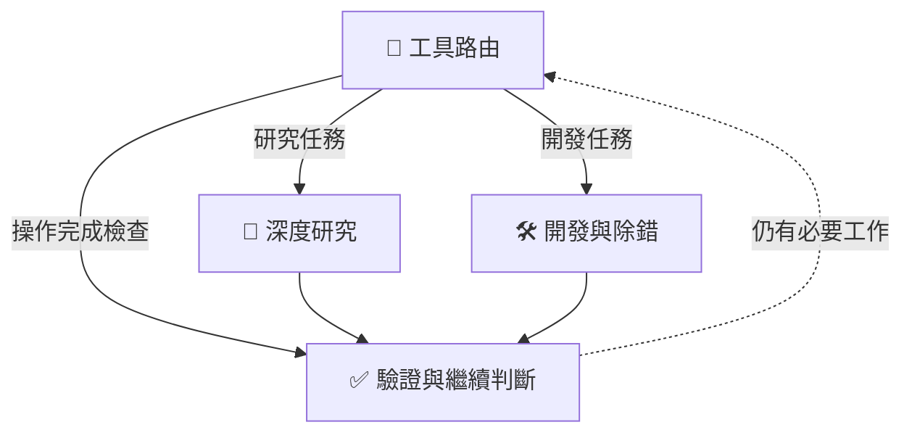

<div align="center">

# 🧭 Intelligent Tool Router

## 🧭 讓 AI 選對工具，查清來源，驗證結果

**四個 Skills：工具路由、深度研究、開發除錯、完成驗證。**<br>
*Route tools. Trace sources. Verify outcomes.*

把 **Intelligent Tool Router** 加進你的 AI 工作流程，讓選工具、查來源和完成宣稱接受檢查。

[](LICENSE)
[](plugin.json)
[](#skills)
[](#about)
[](README_EN.md)

**繁體中文** · [English](README_EN.md)

[安裝與快速開始](#quick-start) · [使用範例](#examples) · [取得與建構](#packaging) · [深入文件](#references)

</div>

---

<a name="about"></a>

當 AI 能呼叫多種工具時，難點不只是「有沒有工具」，還包括如何選擇、追查來源、處理失敗，以及確認結果是否真的達成目標。

**Intelligent Tool Router 提供四個可按需載入的 Skills，協助模型依任務選工具、追查證據、處理開發問題並檢查完成狀態。**

Intelligent Tool Router 把選工具、深度研究、開發除錯與完成驗證整理成四個按需載入的 Skills，為模型提供明確的檢查與恢復流程。

> 💡 少一點「相信我」，多一點「這是證據」。

## ⚡ 你想改善哪一種 AI 壞習慣？

| 常見狀況 | 這套 Skills 要求模型怎麼處理 |
| --- | --- |
| 🗣️ 沒做完，卻先說「完成了」。 | 檢查實際狀態，區分已建立、已儲存、已部署與實際驗證。 |
| 🔁 工具失敗，還一直重複呼叫。 | 依錯誤類型修正、有限重試或換路徑；結果不明的寫入先查狀態。 |
| 🔎 搜了很多，卻沒有可信來源。 | 追查原始來源、版本與日期，去除重複轉載，交代證據缺口。 |
| 🛠️ 修一個 bug，順便弄壞你的其他修改。 | 先檢查現有程式，保留其他修改，安全可行時只還原本次失敗變更。 |

這些是工作流程的設計目標，實際效果可以用你的任務來測試。

核心指令使用英文，介面與啟動提示使用繁體中文。外掛本身不新增 MCP 伺服器或 API 金鑰；實際工具與帳號授權由使用環境提供。

<a name="skills"></a>

## 🧩 四個 Skills，一套工作流程

| Skill | 負責什麼 | 工作重點 |
| --- | --- | --- |
| 🧭 [智慧工具路由](skills/intelligent-tool-routing/SKILL.md) | 理解任務，選擇可用工具與專門流程。 | 利用已有證據；只為具體缺口增加呼叫。 |
| 🔎 [深度研究路由](skills/deep-research-routing/SKILL.md) | 追蹤來源、識別碼、日期與搜尋分支。 | 三次不同搜尋無新證據時關閉該分支，探索有價值的替代路徑。 |
| 🛠️ [開發工具路由](skills/development-routing/SKILL.md) | 檢查程式、版本與紀錄，診斷、修正、驗證。 | 保留其他修改；安全可行時，只還原本次失敗變更。 |
| ✅ [驗證與停止](skills/verification-and-stop/SKILL.md) | 核對完成宣稱，判斷是否仍有必要工作。 | 依實際證據區分已儲存、已部署與實際驗證。 |



按任務載入需要的 Skill；一般對話或簡單算術可以直接回答。

<a name="quick-start"></a>

## 🚀 安裝與快速開始

> **目前儲存庫仍為 Private。** 只有獲授權的 GitHub 帳號可以取得原始碼；加入 MIT 授權不會將它自動公開。以下流程適用於已取得套件的人，且安裝功能依 AI 用戶端而異。

### 1. 取得完整套件

以有權存取此儲存庫的帳號登入 GitHub，再透過 **Code → Download ZIP** 下載並解壓，或使用：

```sh
git clone https://github.com/y1chenk/intelligent-tool-router.git
cd intelligent-tool-router
python3 scripts/build_package.py --check
```

`--check` 是唯讀的基本套件與 manifest 一致性檢查，**不是安裝，也不是 AI 行為評測**。在 Windows 上可將 `python3` 改成 `python` 或 `py -3`。

### 2. 選擇安裝方式

**方式 A — 匯入完整 Plugin（用戶端有支援時）**

- 在儲存庫根目錄執行 `python3 scripts/build_package.py --output ../intelligent-tool-router-0.2.1.zip`。
- 使用用戶端**實際提供**的 Plugin 匯入、ZIP 上傳或本機 Marketplace 安裝流程加入套件；不是每個聊天介面都支援直接上傳 ZIP 來安裝 Plugin。
- 完整套件包含根目錄 `plugin.json`、相容 manifest、四個 `skills/` 資料夾及參考檔案；不會自動建立 MCP 伺服器或 API 金鑰。

**方式 B — 手動安裝四個 Skills（支援檔案型 Skills 的環境）**

把 `skills/` **下面的四個完整資料夾**複製到目標 Skills 目錄，保留各資料夾中的 `SKILL.md`、`agents/` 與 `references/`。

| 用戶端 | 專案層級的放置位置 | 備註 |
| --- | --- | --- |
| Codex | `<專案>/.agents/skills/<skill-name>/SKILL.md` | 將四個 Skill 直接放在 `.agents/skills/` 下。 |
| Claude Code | `<專案>/.claude/skills/<skill-name>/SKILL.md` | 也可使用個人目錄 `~/.claude/skills/`。 |
| 其他 Agent / ChatGPT | 依目前版本提供的 Skill／Plugin 匯入方式 | 不保證有相同的本機目錄或直接呼叫語法。 |

例如 `<skill-name>` 可替換成 `intelligent-tool-routing`；請勿只複製單一 `SKILL.md` 而漏掉其參考檔。各平台的最新安裝方式請參考 [OpenAI Plugin 文件](https://developers.openai.com/plugins/build/plugins) 與 [Claude Skills 文件](https://platform.claude.com/docs/en/agents-and-tools/agent-skills/overview)。

### 3. 驗證安裝並開始使用

1. 確認目標目錄存在 `intelligent-tool-routing/SKILL.md` 等四個 Skill，並確認其參考檔案齊全。
2. 重新整理或重新開啟用戶端（如果該用戶端要求），確認 Skills / Plugin 列表可以找到它們。
3. 在支援 Plugin 提及的聊天中使用 **@Intelligent Tool Router**；在支援 `$skill-name` 呼叫的環境中，可使用以下範本。實際名稱與觸發語法依用戶端而定。

```text
使用 $intelligent-tool-routing 處理以下任務：
目標：【你要完成的工作】
限制：【預算、範圍、時間或禁止更動的項目】
完成標準：【需要的成果、來源或驗證方法】
```

也可以選用 `$deep-research-routing`、`$development-routing`、`$verification-and-stop`。**能看見 Skill，不代表模型已可靠遵循；請用具體任務和可核對的輸出測試。**

<a name="examples"></a>

## 🎯 可直接使用的範例

<details>
<summary>🧭 選工具與執行任務</summary>

```text
使用 $intelligent-tool-routing 完成【任務】。
先確認可用能力與已有證據，再選擇適合的工具。
完成後提供成果，以及能核對完成狀態的證據。
```

</details>

<details>
<summary>🔎 深挖與來源查證</summary>

```text
使用 $deep-research-routing，deep dig【主題】。
優先官方與原始來源，追蹤識別碼、版本和日期。
附完整來源網址、證據等級，以及尚未覆蓋的範圍。
```

</details>

<details>
<summary>🛠️ 除錯與程式修復</summary>

```text
使用 $development-routing 查明【錯誤】的原因。
先讀相關程式、版本與執行紀錄，再依授權範圍修正。
保留我的其他修改，驗證原本的問題與受影響介面。
```

</details>

<details>
<summary>✅ 檢查是否真的完成</summary>

```text
使用 $verification-and-stop 檢查【結果】的完成宣稱。
依現有證據區分已建立、已儲存、已部署與實際驗證。
指出證據不足的部分，以及仍有必要執行的檢查。
```

</details>

更多情境與反例：[12 個路由案例](skills/intelligent-tool-routing/references/examples.md)。

<a name="packaging"></a>

## 📦 取得原始碼與建構

想研究、修改或協助改進專案？你可以使用 **Code → Download ZIP**，或用 Git 下載原始碼。

<details>
<summary>🧑‍💻 開發者指引：下載、檢查與封裝</summary>

以下步驟用於取得與檢查來源套件；日常使用已安裝的外掛，不需要反覆執行。

```sh
git clone https://github.com/y1chenk/intelligent-tool-router.git
cd intelligent-tool-router
python3 scripts/build_package.py --check
```

封裝腳本僅使用 Python 標準函式庫。Windows 若沒有 `python3`，可改用 `python` 或 `py -3`。使用 Download ZIP 時，請將解壓後的根目錄命名為 `intelligent-tool-router`。

產生可匯入的 ZIP：

```sh
python3 scripts/build_package.py --output ../intelligent-tool-router-0.2.1.zip
```

| 指令 | 處理內容 |
| --- | --- |
| `--check` | 唯讀檢查雙 manifest 一致性與基本套件條件。 |
| `--output` | 同步相容 manifest，將雙語 README、四個 Skills 與參考資料封裝到根目錄外的 ZIP。 |

共同 metadata 以根目錄的 `plugin.json` 為準，`.codex-plugin/plugin.json` 保存相容設定。依用戶端支援的外掛或 Skills 匯入流程安裝，並保留完整的 `agents/` 與 `references/` 資料。

</details>

<a name="references"></a>

## 📚 深入文件

| 文件 | 內容 |
| --- | --- |
| [路由案例](skills/intelligent-tool-routing/references/examples.md) | 12 個正反例與完成宣稱的界線。 |
| [能力對照](skills/intelligent-tool-routing/references/capability-routes.md) | 依需求選擇資料來源與工具能力。 |
| [使用環境參考](skills/intelligent-tool-routing/references/host-profile.md) | 不同產品與環境的條件式範例。 |
| [研究紀錄 Schema](skills/deep-research-routing/references/ledger.schema.json) | 來源、識別碼與搜尋分支的結構化格式。 |
| [研究紀錄版本政策](skills/deep-research-routing/references/ledger-versioning.md) | 核心相容性、擴充與版本遷移。 |
| [版本紀錄](CHANGELOG.md) | 已發布版本與後續修改。 |

## 💬 回饋與改進

可透過 [Issues](https://github.com/y1chenk/intelligent-tool-router/issues) 提供實際使用案例：任務目標、可用工具、預期結果、實際結果與可重現步驟。選工具錯誤、不必要的重複呼叫，以及缺少證據的完成宣稱，都是有用的改進線索。

## 🧪 帶著你的真實任務來挑戰它

找一個你熟悉的任務，分別在使用與未使用 Router 的新對話中執行。比較結果是否正確、來源能否查證、完成宣稱是否有依據，以及工具呼叫與耗時。把失敗案例帶回來，讓下一次改進有根據。

<details>
<summary>📝 版本、效果與授權說明</summary>

目前套件版本為 **v0.2.1**。Skills 提供模型行為指引，不是強制攔截器，也不保證消除錯誤或幻覺。自動觸發、遵循率與效能改善需要實際任務評測；封裝檢查不等同模型可靠性測試，也不代替完整 manifest 或 JSON Schema 驗證。本專案採用 [MIT License](LICENSE)；目前儲存庫仍為私人模式，授權不會自動變更存取權限。

</details>

---

<div align="center">

🧭 **Intelligent Tool Router** · [English](README_EN.md) · [Changelog](CHANGELOG.md)

</div>
