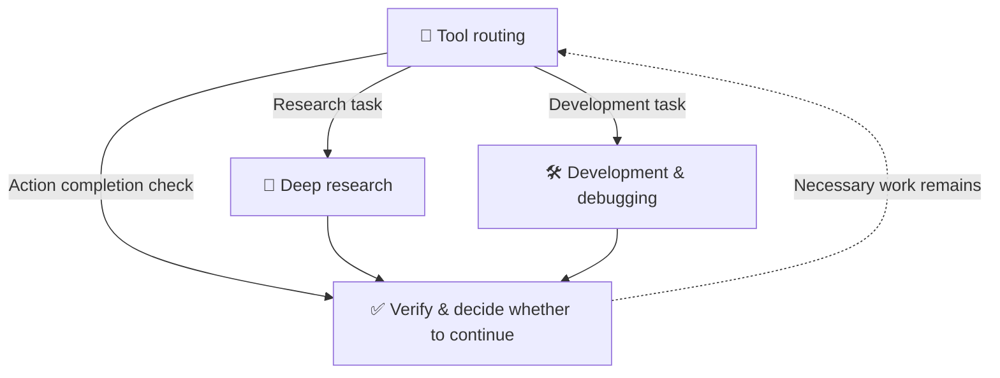

<div align="center">

# 🧭 Intelligent Tool Router

## 🧭 Better tool choices. Traceable research. Verifiable outcomes.

**Four Skills for tool routing, deep research, development, and completion checks.**<br>
*選對工具、追查來源、驗證成果。*

Add **Intelligent Tool Router** to your AI workflow and put tool choices, sources, and completion claims under scrutiny.

[](LICENSE)
[](plugin.json)
[](#skills)
[](#about)
[](README.md)

[繁體中文](README.md) · **English**

[Installation & quick start](#quick-start) · [Examples](#examples) · [Source & packaging](#packaging) · [Reference docs](#references)

</div>

---

<a name="about"></a>

When an AI can call multiple tools, the challenge is not just access: it also needs to choose suitable tools, trace sources, recover from failures, and check whether the intended outcome was reached.

**Intelligent Tool Router provides four on-demand Skills to guide tool selection, evidence tracing, development workflows, and completion checks.**

Intelligent Tool Router organizes tool selection, deep research, debugging, and completion verification into four skills loaded as needed, giving the model explicit inspection and recovery workflows.

> 💡 Less “trust me.” More “here is the evidence.”

## ⚡ Which AI habit do you want to improve?

| Common pattern | What these skills ask the model to do |
| --- | --- |
| 🗣️ Saying “Done” before the work is complete. | Inspect actual state; distinguish created, saved, deployed, and operationally verified outcomes. |
| 🔁 Repeating failed tool calls. | Correct parameters, retry within bounds, or change paths; inspect uncertain writes before retrying. |
| 🔎 Searching widely without credible sources. | Trace original sources, versions, and dates; deduplicate copied reporting and explain evidence gaps. |
| 🛠️ Fixing one bug while disrupting your other edits. | Inspect existing code, preserve unrelated edits, and restore only the failed attempt when safe. |

These are workflow design goals. Test their effects on your own tasks.

Core instructions are in English. Interface text and starter prompts are in Traditional Chinese. The plugin adds no MCP servers or API keys; the host supplies available tools and account permissions.

<a name="skills"></a>

## 🧩 Four skills, one workflow

| Skill | Responsibility | Working principle |
| --- | --- | --- |
| 🧭 [Tool routing](skills/intelligent-tool-routing/SKILL.md) | Understand the task and select available tools and specialized workflows. | Reuse evidence; add calls for concrete gaps. |
| 🔎 [Deep research](skills/deep-research-routing/SKILL.md) | Track sources, identifiers, dates, and research branches. | Close a branch after three distinct searches yield no new evidence; explore promising alternatives. |
| 🛠️ [Development routing](skills/development-routing/SKILL.md) | Inspect code, versions, and logs; diagnose, change, and validate. | Preserve unrelated edits; restore only the failed attempt when safe. |
| ✅ [Verification & stopping](skills/verification-and-stop/SKILL.md) | Check completion claims and decide whether necessary work remains. | Match saved, deployed, and operationally verified claims to evidence. |



Load the skills relevant to the task. Ordinary conversation and simple arithmetic can be answered directly.

<a name="quick-start"></a>

## 🚀 Installation & quick start

> **This repository is still private.** Only authorized GitHub accounts can download its contents. An MIT license does **not** make the repository public. The steps below are for people who already have access, and installation depends on the AI client.

### 1. Obtain the complete package

Sign in to GitHub with a permitted account and use **Code → Download ZIP**, then extract it; or run:

```sh
git clone https://github.com/y1chenk/intelligent-tool-router.git
cd intelligent-tool-router
python3 scripts/build_package.py --check
```

`--check` performs read-only basic package and manifest-consistency checks. It **does not install the plugin or test AI behavior**. On Windows, use `python` or `py -3` if `python3` is unavailable.

### 2. Choose an installation method

**Option A — Install the complete Plugin (when supported by your client)**

- From the repository root, run `python3 scripts/build_package.py --output ../intelligent-tool-router-0.2.1.zip`.
- Follow your client's **actual** Plugin import, ZIP upload, or local Marketplace workflow. Uploading a ZIP as an ordinary chat attachment does not necessarily install a Plugin.
- The package contains root `plugin.json`, the compatibility manifest, four complete `skills/` folders, and reference files. It does not provision MCP servers or API keys.

**Option B — Install the four Skills manually (filesystem-based clients)**

Copy **each of the four complete folders inside** `skills/` into your client's Skills directory. Keep their `SKILL.md`, `agents/`, and `references/` files together.

| Client | Project-level target path | Notes |
| --- | --- | --- |
| Codex | `<project>/.agents/skills/<skill-name>/SKILL.md` | Place each of the four skill folders directly under `.agents/skills/`. |
| Claude Code | `<project>/.claude/skills/<skill-name>/SKILL.md` | Personal installs can also use `~/.claude/skills/`. |
| Other agents / ChatGPT | Use the import process supported by your client version | No universal local path or invocation syntax is assumed. |

For example, replace `<skill-name>` with `intelligent-tool-routing`. Copying only its `SKILL.md` omits required reference resources. Consult the current [OpenAI Plugin documentation](https://developers.openai.com/plugins/build/plugins) and [Claude Skills documentation](https://platform.claude.com/docs/en/agents-and-tools/agent-skills/overview) for host-specific installation.

### 3. Verify the installation and start

1. Confirm that all four Skills, including `intelligent-tool-routing/SKILL.md`, and their reference files exist in the target location.
2. Refresh or restart your client if required, and check that the Skills / Plugin appear in its listing.
3. In a chat supporting Plugin mentions, use **@Intelligent Tool Router**. If your client supports `$skill-name` invocation, adapt this example; actual invocation syntax differs by client.

```text
Use $intelligent-tool-routing for this task:
Goal: [the work to complete]
Constraints: [budget, scope, time, or items that must be preserved]
Completion criteria: [required output, sources, or validation method]
```

You can also choose `$deep-research-routing`, `$development-routing`, or `$verification-and-stop`. **Discovery does not prove reliable adherence; verify behavior on concrete tasks with checkable results.**

<a name="examples"></a>

## 🎯 Ready-to-use examples

<details>
<summary>🧭 Tool selection and execution</summary>

```text
Use $intelligent-tool-routing to complete [task].
Inspect available capabilities and existing evidence, then select suitable tools.
Deliver the result with evidence that supports its completion state.
```

</details>

<details>
<summary>🔎 Deep research and source verification</summary>

```text
Use $deep-research-routing to deep dig [topic].
Prioritize official and original sources; track identifiers, versions, and dates.
Include complete source URLs, evidence grades, and coverage limits.
```

</details>

<details>
<summary>🛠️ Debugging and code repair</summary>

```text
Use $development-routing to diagnose [error].
Read relevant code, versions, and logs; make changes within the authorized scope.
Preserve my other edits and validate the original problem and affected interfaces.
```

</details>

<details>
<summary>✅ Checking whether work is complete</summary>

```text
Use $verification-and-stop to check completion claims for [result].
Distinguish created, saved, deployed, and operationally verified states using evidence.
Identify unsupported claims and any checks that are still necessary.
```

</details>

More scenarios: [12 routing examples and counterexamples](skills/intelligent-tool-routing/references/examples.md).

<a name="packaging"></a>

## 📦 Source and packaging

Want to inspect, modify, or help improve the project? Use **Code → Download ZIP**, or clone the source with Git.

<details>
<summary>🧑‍💻 Developer guide: clone, check, and package</summary>

These steps download and check the source package. You do not need to repeat them for everyday use of an installed plugin.

```sh
git clone https://github.com/y1chenk/intelligent-tool-router.git
cd intelligent-tool-router
python3 scripts/build_package.py --check
```

The packaging script uses only the Python standard library. On Windows, use `python` or `py -3` if `python3` is unavailable. If you use Download ZIP, name the extracted root directory `intelligent-tool-router`.

Build an importable ZIP:

```sh
python3 scripts/build_package.py --output ../intelligent-tool-router-0.2.1.zip
```

| Command | What it does |
| --- | --- |
| `--check` | Read-only manifest consistency and basic package checks. |
| `--output` | Synchronize the compatibility manifest and package both READMEs, four skills, and references into a ZIP outside the plugin root. |

Root `plugin.json` owns shared metadata; `.codex-plugin/plugin.json` preserves compatibility settings. Use your client's supported plugin or skill import flow, keeping complete `agents/` and `references/` resources.

</details>

<a name="references"></a>

## 📚 Reference docs

| Document | Contents |
| --- | --- |
| [Routing examples](skills/intelligent-tool-routing/references/examples.md) | Twelve examples, counterexamples, and completion limits. |
| [Capability routes](skills/intelligent-tool-routing/references/capability-routes.md) | Choose source and tool capabilities for a concrete need. |
| [Host reference](skills/intelligent-tool-routing/references/host-profile.md) | Conditional examples for different products and environments. |
| [Research ledger schema](skills/deep-research-routing/references/ledger.schema.json) | Structured sources, identifiers, and research branches. |
| [Ledger versioning](skills/deep-research-routing/references/ledger-versioning.md) | Core compatibility, extensions, and migrations. |
| [Changelog](CHANGELOG.md) | Released versions and subsequent changes. |

## 💬 Feedback and improvements

Use [Issues](https://github.com/y1chenk/intelligent-tool-router/issues) to share real cases: the goal, available tools, expected and observed results, and reproduction steps. Incorrect tool selection, unnecessary repeated calls, and unsupported completion claims are useful improvement targets.

## 🧪 Bring a real task and challenge it

Choose a task you know well and run it in fresh chats with and without the Router. Compare correctness, verifiable sources, evidence for completion claims, tool calls, and elapsed time. Share failures so the next improvement has something concrete to address.

<details>
<summary>📝 Version, effectiveness, and licensing</summary>

The package is **v0.2.1**. Skills guide model behavior; they are not enforcement middleware and do not guarantee the elimination of errors or hallucinations. Automatic triggering, adherence, and performance gains require real task evaluations. Packaging checks do not establish model reliability or replace complete manifest or JSON Schema validation. This project uses the [MIT License](LICENSE). Its GitHub repository remains private; the license does not change access permissions.

</details>

---

<div align="center">

🧭 **Intelligent Tool Router** · [繁體中文](README.md) · [Changelog](CHANGELOG.md)

</div>
